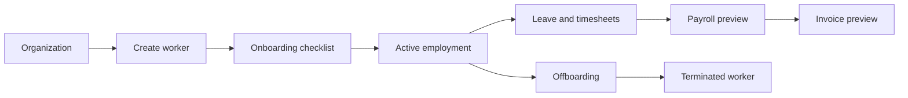
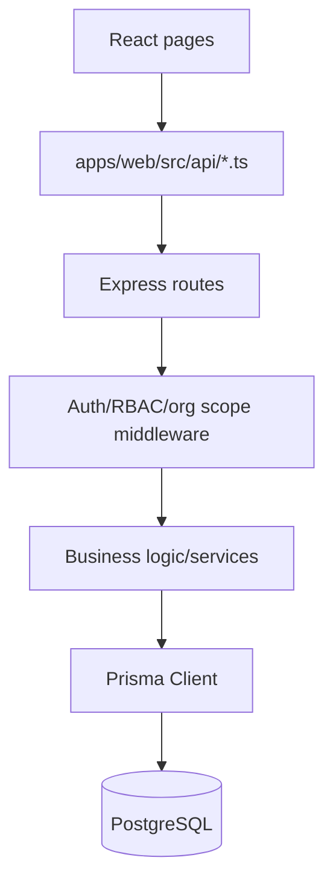

# Codebase Overview

## What The App Does

GlobalHire Lite is a lightweight Employer of Record style demo app. It helps a client company manage international workers through a simplified lifecycle:

This is not a real payroll, legal, compliance, or HRIS product. The code intentionally uses simplified rules so the project can demonstrate full-stack workflow software without trying to model real employment law.

## Core Business Domain

The domain is international workforce operations:

- A client organization hires workers in different countries.
- Each worker has employment terms such as salary, start date, contract status, and employment type.
- Country rules create demo onboarding requirements and payroll estimate assumptions.
- Workers submit tasks/documents, leave requests, and timesheets.
- Managers or internal specialists approve workflow steps.
- Payroll runs produce payroll items and totals.
- Approved payroll can generate an invoice.
- Offboarding ends employment and terminates the worker record.

## Main User Roles

The roles are defined in [packages/shared/src/index.ts](../../packages/shared/src/index.ts) and in Prisma enum `Role` in [apps/api/prisma/schema.prisma](../../apps/api/prisma/schema.prisma).

- `PLATFORM_ADMIN`: platform-level user; can see/manage broad platform data.
- `EOR_SPECIALIST`: internal operations user; handles onboarding, payroll approval, document review, and offboarding completion.
- `CLIENT_ADMIN`: client HR/admin user; manages workers and client-side payroll/offboarding actions.
- `CLIENT_MANAGER`: manager-style approver for leave and timesheets.
- `WORKER`: can see their own worker/profile-related data.

## Main Workflows

The most important implemented workflows are:

- Login as a demo user: [apps/web/src/features/auth/LoginPage.tsx](../../apps/web/src/features/auth/LoginPage.tsx) -> [apps/api/src/modules/auth/auth.routes.ts](../../apps/api/src/modules/auth/auth.routes.ts)
- Create worker: [apps/web/src/features/workers/NewWorkerPage.tsx](../../apps/web/src/features/workers/NewWorkerPage.tsx) -> [apps/api/src/modules/workers/workers.service.ts](../../apps/api/src/modules/workers/workers.service.ts)
- Submit/approve onboarding tasks: [apps/web/src/features/workers/WorkerDetailPage.tsx](../../apps/web/src/features/workers/WorkerDetailPage.tsx) -> [apps/api/src/modules/onboarding/onboarding.routes.ts](../../apps/api/src/modules/onboarding/onboarding.routes.ts)
- Approve leave/timesheets: [apps/web/src/features/leave/LeavePage.tsx](../../apps/web/src/features/leave/LeavePage.tsx), [apps/web/src/features/timesheets/TimesheetsPage.tsx](../../apps/web/src/features/timesheets/TimesheetsPage.tsx)
- Payroll calculation and state transitions: [apps/api/src/modules/payroll/payroll.service.ts](../../apps/api/src/modules/payroll/payroll.service.ts)
- Invoice generation: [apps/api/src/modules/invoices/invoices.service.ts](../../apps/api/src/modules/invoices/invoices.service.ts)
- Offboarding: [apps/api/src/modules/offboarding/offboarding.routes.ts](../../apps/api/src/modules/offboarding/offboarding.routes.ts)

## Tech Stack

Frontend:

- React
- TypeScript
- Vite
- React Router
- TanStack Query
- React Hook Form
- Zod
- Tailwind CSS

Backend:

- Node.js
- Express
- TypeScript
- Prisma ORM
- PostgreSQL
- Zod validation
- JWT auth in an HTTP-only cookie

Testing:

- Vitest backend unit tests
- React Testing Library frontend smoke tests

## Frontend, Backend, And Database Relationship

The frontend runs at `http://localhost:5173`. It calls the API through [apps/web/src/api/client.ts](../../apps/web/src/api/client.ts), which defaults to `http://localhost:4000/api`.

The backend runs at `http://localhost:4000`. Express mounts public auth routes first, then applies `requireAuth`, then mounts protected domain routes in [apps/api/src/app.ts](../../apps/api/src/app.ts).

PostgreSQL stores the application data. Prisma maps the schema in [apps/api/prisma/schema.prisma](../../apps/api/prisma/schema.prisma) to TypeScript database calls through the Prisma Client imported in [apps/api/src/db/prisma.ts](../../apps/api/src/db/prisma.ts).

## 2-Minute Interview Pitch

GlobalHire Lite is a full-stack Employer of Record workflow demo. It models how a company might manage international workers from hire request through onboarding, leave, timesheets, payroll preview, invoicing, and offboarding. I built it with React, Node, Express, TypeScript, Prisma, and PostgreSQL to show realistic CRUD plus workflow state transitions. The interesting parts are role-based access, multi-tenant organization scoping, country-rule-driven onboarding, payroll calculation rules, and audit logging. I kept it intentionally lightweight: the app does not try to implement real payroll or legal compliance. Instead, it shows where those systems would plug in and keeps the code readable enough to explain in an interview.
