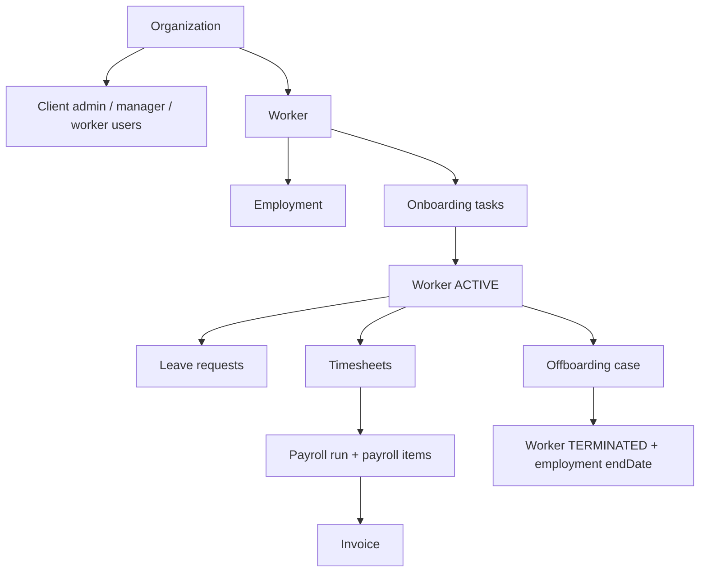

# Domain Model Explained

The source of truth is [apps/api/prisma/schema.prisma](../../apps/api/prisma/schema.prisma).

## Lifecycle Overview

## Organization

Real-world concept: a client company using the platform.

Important fields:

- `name`
- `industry`
- `headquartersCountry`
- `status`

Relationships:

- Has many `User`
- Has many `Worker`
- Has many `PayrollRun`
- Has many `Invoice`
- Has many `AuditLog`

Workflows:

- Worker creation
- Payroll
- Invoice
- Dashboard scoping

Constraints/assumptions:

- Most tenant scoping flows through `organizationId`.
- Platform users may not belong to an organization.

## User

Real-world concept: a person who logs into the app.

Important fields:

- `email`
- `passwordHash`
- `firstName`
- `lastName`
- `role`
- `organizationId`

Relationships:

- Optional organization.
- Optional `workerProfile` if the user is also a worker.
- Can review onboarding tasks, leave, timesheets.
- Can create/approve payroll runs.
- Can request offboarding.

Workflows:

- Auth
- RBAC
- Audit attribution

Constraints/assumptions:

- Email is unique.
- `organizationId` is nullable for platform/internal users.
- Worker users are linked to `Worker` through `Worker.userId`.

## Worker

Real-world concept: an international worker managed through the EOR workflow.

Important fields:

- `organizationId`
- `userId`
- `managerId`
- `firstName`, `lastName`, `email`
- `countryCode`
- `jobTitle`, `department`
- `employmentType`
- `status`
- `startDate`

Relationships:

- Belongs to `Organization`
- Optional linked `User`
- Optional manager `User`
- Has one `Employment`
- Has many onboarding tasks, documents, leave requests, timesheets, payroll items, offboarding cases

Workflows:

- Hire request
- Onboarding
- Activation
- Leave/timesheets
- Payroll
- Offboarding

Constraints/assumptions:

- `userId` is unique and nullable.
- `organizationId` and `email` are indexed.
- Worker status is an enum, not a formal state machine.

## Employment

Real-world concept: the worker’s employment terms.

Important fields:

- `workerId`
- `salaryAmount`
- `salaryCurrency`
- `employmentType`
- `startDate`
- `endDate`
- `contractStatus`

Relationships:

- One-to-one with `Worker`.

Workflows:

- Worker creation creates Employment.
- Worker activation requires `contractStatus === SIGNED`.
- Payroll uses salary fields.
- Offboarding completion sets `endDate`.

Constraints/assumptions:

- `workerId` is unique.
- Salary is a simple `Float`; production systems usually use integer minor units or decimal.

## CountryRule

Real-world concept: simplified country-specific rule template.

Important fields:

- `countryCode`
- `countryName`
- `currency`
- `probationPeriodDays`
- `statutoryVacationDays`
- `noticePeriodDays`
- `requiresTaxId`
- `requiresBankDetails`
- `requiresSignedContract`
- `employerCostPercent`
- `employeeTaxPercent`

Relationships:

- No direct FK to Worker; workers reference country via `countryCode`.

Workflows:

- Worker creation uses rules to generate onboarding tasks.
- Payroll uses tax/cost percentages.
- Worker detail shows country rule summary.

Constraints/assumptions:

- `countryCode` is unique.
- Values are demo data, not real legal/payroll advice.

## OnboardingTask

Real-world concept: checklist item a worker must complete before activation.

Important fields:

- `workerId`
- `title`
- `description`
- `category`
- `required`
- `status`
- `submittedAt`
- `reviewedAt`
- `reviewedById`
- `rejectionReason`

Relationships:

- Belongs to `Worker`
- Optional reviewer `User`

Workflows:

- Generated when worker is created.
- Submitted by worker/client admin.
- Approved/rejected by EOR specialist/platform admin.
- Activation requires all required tasks to be `APPROVED`.

Constraints/assumptions:

- Status transitions are enforced by route/service checks, not database constraints.

## WorkerDocument

Real-world concept: metadata record for an uploaded worker document.

Important fields:

- `workerId`
- `uploadedById`
- `fileName`
- `documentType`
- `status`

Relationships:

- Belongs to `Worker`
- Uploaded by `User`

Workflows:

- Document metadata creation.
- Document approve/reject.

Constraints/assumptions:

- No actual file storage is implemented.
- No storage URL, file size, content type, or virus scan status.

## LeaveRequest

Real-world concept: worker request for time off.

Important fields:

- `workerId`
- `leaveType`
- `startDate`
- `endDate`
- `reason`
- `status`
- `reviewedById`
- `reviewedAt`

Relationships:

- Belongs to `Worker`
- Optional reviewer `User`

Workflows:

- Worker/backend can create leave.
- Manager/admin/EOR can approve/reject.
- Worker dashboard calculates approved leave days.

Constraints/assumptions:

- No accrual engine.
- No overlap validation.
- No calendar/holiday logic.

## Timesheet

Real-world concept: weekly hours summary.

Important fields:

- `workerId`
- `weekStartDate`
- `regularHours`
- `overtimeHours`
- `notes`
- `status`
- `reviewedById`
- `reviewedAt`

Relationships:

- Belongs to `Worker`
- Optional reviewer `User`

Workflows:

- Worker/backend can submit timesheets.
- Manager/admin/EOR can approve/reject.
- Approved overtime affects payroll.

Constraints/assumptions:

- Weekly summary only.
- No daily entries.
- No duplicate week prevention.

## PayrollRun

Real-world concept: payroll preview for an organization and pay period.

Important fields:

- `organizationId`
- `periodStart`
- `periodEnd`
- `status`
- `currency`
- `grossTotal`
- `employeeTaxTotal`
- `employerCostTotal`
- `netTotal`
- `createdById`
- `approvedById`
- `approvedAt`
- `lockedAt`

Relationships:

- Belongs to `Organization`
- Created by `User`
- Optional approved by `User`
- Has many `PayrollItem`
- Has optional `Invoice`

Workflows:

- Created as `DRAFT`.
- Calculated to `CALCULATED`.
- Approved to `APPROVED`.
- Locked to `LOCKED`.

Constraints/assumptions:

- Totals are floats.
- No real tax/payroll compliance.
- Locked status is checked by service logic, not database triggers.

## PayrollItem

Real-world concept: one worker’s calculated payroll line.

Important fields:

- `payrollRunId`
- `workerId`
- `grossPay`
- `overtimePay`
- `employeeTax`
- `employerCost`
- `netPay`
- `currency`

Relationships:

- Belongs to `PayrollRun`
- Belongs to `Worker`

Workflows:

- Created during payroll calculation.
- Displayed in payroll detail and worker detail.

Constraints/assumptions:

- Recalculation deletes and recreates items for the run.

## Invoice

Real-world concept: client invoice preview based on payroll totals.

Important fields:

- `organizationId`
- `payrollRunId`
- `invoiceNumber`
- `subtotal`
- `platformFee`
- `total`
- `currency`
- `status`
- `dueDate`

Relationships:

- Belongs to `Organization`
- One-to-one with `PayrollRun`

Workflows:

- Generated after payroll is approved or locked.
- Can be issued or marked paid.

Constraints/assumptions:

- No payment integration.
- No PDF generation.
- `payrollRunId` and `invoiceNumber` are unique.

## OffboardingCase

Real-world concept: termination/offboarding workflow.

Important fields:

- `workerId`
- `requestedById`
- `reason`
- `lastWorkingDay`
- `status`
- `notes`

Relationships:

- Belongs to `Worker`
- Requested by `User`

Workflows:

- Request sets worker `OFFBOARDING`.
- Completion sets case `COMPLETED`, worker `TERMINATED`, employment `endDate`.

Constraints/assumptions:

- No notice period enforcement.
- No final payroll logic beyond status changes.

## AuditLog

Real-world concept: event history for important HR/payroll actions.

Important fields:

- `organizationId`
- `actorUserId`
- `entityType`
- `entityId`
- `action`
- `message`
- `metadataJson`
- `createdAt`

Relationships:

- Optional organization.
- Optional actor user.

Workflows:

- Worker creation
- Onboarding task events
- Leave/timesheet approvals
- Payroll calculation/approval
- Invoice generation/issue
- Offboarding request/completion

Constraints/assumptions:

- Audit log is append-only by convention, not enforced by database permissions.
